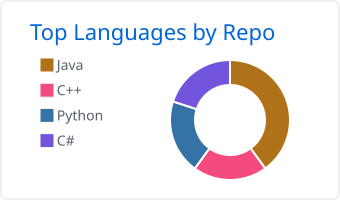
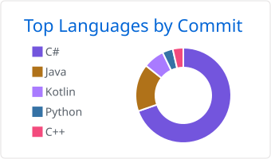
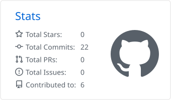
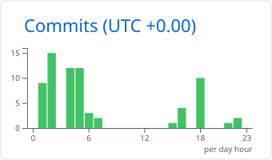

<h1 align="left">Jeimy Espinoza Barquero</h1>

<strong>Full-Stack Developer · Scrum Master · Information Systems Engineering student</strong> 
Universidad Nacional de Costa Rica (UNA) · Heredia, Costa Rica

I build web applications end to end, from the database schema to the interface. For the past 18 months I have worked on a full-stack platform for the Costa Rican Ministry of Health, where I also served as Scrum Master for a 10-person team. I am most interested in backend development, databases, containerization, and clean, usable interfaces.

**Currently:** open to software development internships starting in 2027 · learning Docker, Kubernetes and OpenShift.

---

## Tech Stack

**Frontend** 

**Backend** 

**Data** 
 &nbsp; Oracle DB · SQL

**Tools** 

---

## GitHub Overview

  <picture>
    <source media="(prefers-color-scheme: dark)" srcset="./profile-summary-card-output/github_dark/1-repos-per-language.svg" />
    
  </picture>
  <picture>
    <source media="(prefers-color-scheme: dark)" srcset="./profile-summary-card-output/github_dark/2-most-commit-language.svg" />
    
  </picture>

  <picture>
    <source media="(prefers-color-scheme: dark)" srcset="./profile-summary-card-output/github_dark/3-stats.svg" />
    
  </picture>
  <picture>
    <source media="(prefers-color-scheme: dark)" srcset="./profile-summary-card-output/github_dark/4-productive-time.svg" />
    
  </picture>

---

## Featured Project

### Semilleros — Ministerio de Salud de Costa Rica
Full-stack web platform to register, manage and evaluate innovation initiatives for the Costa Rican Ministry of Health.

- Developed features across the frontend, REST API and Oracle database layers
- Implemented JWT-based authentication and role-based access
- Led the team as Scrum Master across multiple sprints (10 members)

**Stack:** React · JavaScript · C# · ASP.NET Core · Oracle DB · JWT · REST APIs

*Source code is private as part of an institutional project.*

---

## Education

- **B.S. Information Systems Engineering** — Universidad Nacional *(expected 2027)*
- **Associate's Degree in Computer Applications** — Universidad Nacional *(2026)*

## Certifications

- **Scrum Fundamentals Certified (SFC™)** — SCRUMstudy · April 2026

## Languages

Spanish (native) · English (advanced)

---

## Contact

